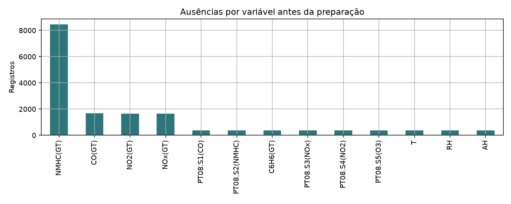
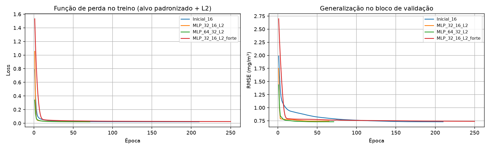
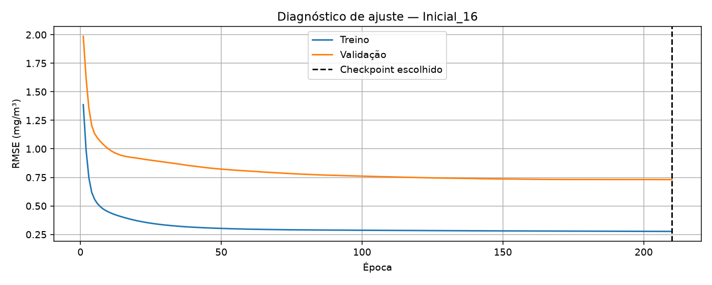
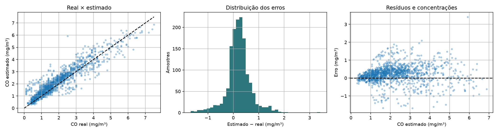
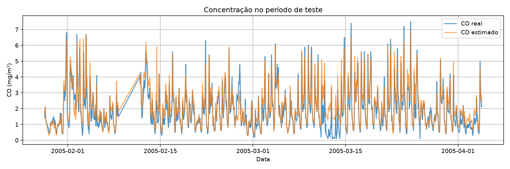

# Documentação da rede neural — CitizenTech

## Capa

**Global Solution 2026.2 — FIAP**  
**Disciplina:** Redes Neurais Artificiais, Deep Learning e Algoritmos Genéticos  
**Projeto:** módulo complementar de monitoramento ambiental urbano  
**Modelo:** MLP para estimativa da concentração horária de CO  
**Integrantes:**

- João Pedro Morangoni — RM 570073
- João Vitor Xavier de Carvalho — RM 570633

Notebook: [qualidade_ar_mlp.ipynb](../rede_neural/qualidade_ar_mlp.ipynb).
Instruções: [IA/README.md](../README.md).
Vídeo: [roteiro de gravação](roteiro_video.md); a gravação ainda depende do grupo.

## 1. Problema e contribuição para CitizenTech

O repositório implementa monitoramento de bueiros com sensores e backend para
acompanhar condições da infraestrutura urbana. Com o dataset solicitado, este trabalho
implementa um módulo complementar: estimar a concentração de monóxido de carbono
no ar em superfície a partir de medições de uma estação ambiental.

O público proposto inclui equipes de manutenção urbana, gestores municipais e
moradores próximos aos pontos monitorados. Uma aplicação futura poderia associar
medições ambientais e infraestrutura em um painel territorial, com valores e horários
visíveis. O benefício social é potencial; não foi medido em campo.

O modelo estima **CO no mesmo horário das entradas**, em mg/m³. Não prevê uma hora
futura. O Air Quality não contém chuva, nível de água, obstrução ou medições internas
de bueiros. Portanto, não sustenta previsões de alagamento nem decisões de segurança
para entrada em espaços confinados. O alinhamento deste módulo complementar com o
problema interdisciplinar deve ser confirmado pelo grupo, pois o enunciado exige
manter problema, público e contexto entre disciplinas.

## 2. Dataset: fonte, características e adequação

**Fonte:** [UCI Machine Learning Repository — Air Quality](https://archive.ics.uci.edu/dataset/360/air+quality).  
**Referência:** Vito, S. (2008). *Air Quality* [Dataset]. UCI Machine Learning Repository.
[DOI 10.24432/C59K5F](https://doi.org/10.24432/C59K5F).

A base reúne médias horárias de um dispositivo com sensores químicos em uma cidade
italiana e concentrações de referência de analisador certificado. Possui sensibilidades
cruzadas, valores ausentes e deriva de sensores, justificando avaliar calibração
multivariada. O portal apresenta CC BY 4.0 e uma observação de uso para pesquisa;
o projeto mantém finalidade acadêmica e atribuição.

O arquivo utilizado é exclusivamente `IA/dataset/AirQualityUCI.csv`, sem downloads
ou substituição do conteúdo. A leitura usa `sep=';'` e `decimal=','`.

| Característica verificada no arquivo local | Valor |
| --- | --- |
| Linhas lidas pelo pandas | 9.471 |
| Linhas inteiramente vazias removidas | 114 |
| Registros com data e hora | 9.357 |
| Período local | 10/03/2004 18:00 a 04/04/2005 14:00 |
| Registros sem CO de referência | 1.683 |
| Registros sem nenhuma das oito entradas | 366 |
| Remoções pela união dos dois critérios | 2.013 |
| Registros efetivamente usados | 7.344 |

Os conjuntos removidos se sobrepõem; não se somam 1.683 e 366 diretamente.
A página UCI informa 9.358 instâncias e outro resumo de período; as contagens acima
refletem a inspeção do CSV local, sem fabricar um registro adicional.

SHA-256 do arquivo:

```text
13277ae5d8581e80b7be09d47c7d3d06fe9b8e957078f2cf6e859f955e62f996
```

### Entradas e saída

| Campo | Papel |
| --- | --- |
| `PT08.S1(CO)` | Resposta de sensor nominalmente associado a CO |
| `PT08.S2(NMHC)` | Resposta de sensor nominalmente associado a hidrocarbonetos |
| `PT08.S3(NOx)` | Resposta de sensor nominalmente associado a NOx |
| `PT08.S4(NO2)` | Resposta de sensor nominalmente associado a NO2 |
| `PT08.S5(O3)` | Resposta de sensor nominalmente associado a O3 |
| `T` | Temperatura em °C |
| `RH` | Umidade relativa em % |
| `AH` | Umidade absoluta, na escala fornecida pelo dataset |
| `CO(GT)` | Alvo: concentração média horária de CO em mg/m³ |
| `Date`, `Time` | Ordenação temporal e auditoria, sem entrada direta na MLP |

As respostas PT08 não são concentrações de gases. Mantém-se sua escala original
até a padronização. Os outros campos `GT` não entram no modelo: são referências de
laboratório que não estariam disponíveis no dispositivo proposto.

## 3. Preparação e prevenção de vazamento

1. Remover colunas e linhas totalmente vazias.
2. Converter `-200` em ausência nas colunas numéricas.
3. Interpretar datas e horas e verificar datas inválidas ou duplicadas.
4. Remover linhas sem alvo ou sem qualquer medição de entrada.
5. Ordenar e separar treino, validação e teste cronologicamente.
6. Ajustar mediana, indicadores de ausência e escalas apenas no treino.
7. Transformar validação e teste com os objetos já ajustados.

O alvo ausente não é imputado. Não se usa interpolação temporal, evitando depender
de informação futura. Outliers de concentração são preservados, pois podem representar
eventos reais. Não se faz split aleatório das horas.

| Conjunto | Amostras | Início | Fim |
| --- | ---: | --- | --- |
| Treino | 4.406 | 10/03/2004 18:00 | 15/11/2004 10:00 |
| Validação | 1.469 | 15/11/2004 11:00 | 28/01/2005 11:00 |
| Teste | 1.469 | 28/01/2005 12:00 | 04/04/2005 14:00 |

As proporções aproximadas são 60%, 20% e 20%. Cada exemplo usa só as medições da
própria hora. Nenhuma janela ou defasagem atravessa fronteiras de conjuntos.

O pipeline usa `SimpleImputer(strategy='median', add_indicator=True)` seguido de
`StandardScaler`. Neste arquivo, após as remoções, o treino não apresenta ausência
parcial nas oito entradas; por isso não foram criados indicadores adicionais e a
entrada efetiva da rede tem dimensão 8. A imputação permite inferência com ausência
parcial, mas o desempenho nessa condição não foi validado neste experimento.
O alvo também é padronizado e volta à unidade física ao produzir estimativas.



## 4. Arquitetura implementada

Usou-se `sklearn.neural_network.MLPRegressor`. É uma rede neural treinada por
retropropagação com Adam. MLP é adequada a entradas tabulares; CNN não corresponde
à estrutura dos dados e RNN exigiria uma tarefa explícita com sequências.

Arquitetura selecionada: **8 → 16 ReLU → 1 linear**, com **161 parâmetros**:
8 × 16 pesos + 16 vieses na camada oculta, 16 pesos + 1 viés na saída.

```text
8 medições → mediana do treino → escala do treino
           → camada densa (16, ReLU) → saída linear (1)
           → inversão da escala do alvo → máximo entre 0 e a estimativa
           → CO estimado em mg/m³
```

A saída não negativa é um pós-processamento físico aplicado de forma consistente
na validação, teste e inferência. A função de perda usa erro quadrático no alvo
padronizado com penalização L2; os gráficos de RMSE usam mg/m³.

## 5. Treinamento e refinamento

Parâmetros comuns: Adam, semente 42, máximo de 250 épocas, embaralhamento apenas
dentro do treino, paciência 25 e melhora mínima de 0,001 mg/m³ para renovar a paciência.
Cada chamada `partial_fit` executa uma época preservando o estado do otimizador.
Uma cópia dos pesos é guardada sempre que ocorre o menor RMSE de validação,
inclusive quando a melhora é menor que a tolerância da paciência.

O early stopping é manual para respeitar a validação cronológica. A validação interna
aleatória do estimador fica desativada. L2 e seleção de checkpoint são as estratégias
de regularização; não foi implementado dropout. Não se reajusta a rede com treino e
validação unidos após a seleção.

| Configuração | Camadas | LR | Batch | L2 | Épocas executadas | Melhor época | RMSE validação |
| --- | --- | ---: | ---: | ---: | ---: | ---: | ---: |
| Inicial_16 | 16 | 0,001 | 128 | 0,0001 | 210 | 210 | 0,730687 |
| MLP_64_32_L2 | 64, 32 | 0,0005 | 256 | 0,01 | 71 | 49 | 0,730762 |
| MLP_32_16_L2_forte | 32, 16 | 0,0005 | 256 | 0,1 | 250 | 249 | 0,739836 |
| MLP_32_16_L2 | 32, 16 | 0,001 | 128 | 0,01 | 65 | 64 | 0,744049 |

O refinamento **não melhorou o menor RMSE de validação**. A configuração inicial
venceu e foi mantida. A diferença para 64/32 é aproximadamente 0,000076 mg/m³,
insuficiente para afirmar superioridade estatística com uma semente; o critério
predefinido de menor erro selecionou a rede menor. Não houve ajuste posterior com
base nos resultados do teste.



No checkpoint selecionado, o RMSE de treino foi 0,276477 mg/m³ e o de validação
0,730687 mg/m³. A diferença indica generalização imperfeita e é compatível com
sobreajuste e/ou deriva temporal. A base contém mudança nas condições ao longo do
tempo; este desenho não permite atribuir a diferença exclusivamente ao sobreajuste.



## 6. Avaliação e interpretação

As métricas foram calculadas nas 1.469 amostras posteriores do teste, após a seleção.
MAE e RMSE estão em mg/m³; R² é adimensional. A referência constante usa a média
do treino e a Ridge usa `alpha=1` fixo, sem otimização adicional.

| Modelo | MAE | RMSE | R² |
| --- | ---: | ---: | ---: |
| Média do treino | 1,032261 | 1,304244 | -0,005964 |
| Ridge linear | 0,442262 | 0,571054 | 0,807150 |
| MLP inicial / selecionada | **0,384665** | **0,527274** | **0,835586** |

A MLP reduziu o RMSE em **59,57%** frente à média e em **7,67%** frente à Ridge.
Isso evidencia sinal preditivo útil neste recorte, inclusive frente a uma referência
linear. A MLP inicial e a selecionada são o mesmo modelo; a duplicação de linhas no
CSV serve para evidenciar a ausência de ganho dos refinamentos na seleção.

O percentil 95 do erro absoluto foi **1,171560 mg/m³**. Não é um intervalo de
confiança nem um limite garantido para futuras leituras. O erro médio assinado
(estimado − real) foi **+0,214271 mg/m³**, indicando tendência global de superestimação.
Os resíduos mostram dispersão variável e erros grandes em algumas observações.



| Faixa definida pelo treino | n no teste | MAE | RMSE |
| --- | ---: | ---: | ---: |
| CO até 3,0 mg/m³ | 1.210 | 0,359845 | 0,501707 |
| CO acima de 3,0 mg/m³ | 259 | 0,500624 | 0,633186 |

O corte de 3,0 é o percentil 80 do treino, sem significado sanitário. O erro maior
na faixa superior reforça a necessidade de avaliar extremos. Não foram adotados
limites legais, classificações de qualidade do ar ou requisitos operacionais de erro.



O RMSE de teste menor que o de validação não comprova ausência de sobreajuste: os
blocos possuem condições e distribuições diferentes. O resultado é adequado para
demonstrar funcionamento acadêmico. Sem requisitos definidos por responsáveis,
validação local e avaliação de incerteza, não se pode declarar adequação a alertas
públicos, operação municipal ou decisões de segurança.

## 7. Demonstração funcional

O notebook salva e recarrega `modelo_co.joblib`, chama a função
[`estimar_co`](../rede_neural/inferencia.py) e mostra as oito entradas de cinco
amostras espaçadas do teste. A função não recebe CO de referência.

| Instante | CO real | CO estimado |
| --- | ---: | ---: |
| 28/01/2005 12:00 | 1,8 | 1,835755 |
| 16/02/2005 14:00 | 1,5 | 1,903949 |
| 04/03/2005 02:00 | 1,7 | 1,628500 |
| 20/03/2005 01:00 | 1,9 | 1,684758 |
| 04/04/2005 14:00 | 2,2 | 2,604709 |

As entradas completas estão na seção 8 do notebook; saídas e referências estão em
[`demonstracao.csv`](../rede_neural/artefatos/demonstracao.csv).
Os cinco registros não foram usados no treinamento ou na seleção de hiperparâmetros.

O pacote preserva rede, pré-processador, escala do alvo, nomes das features, unidade,
versões e semente. A inferência recebe uma lista de dicionários com nomes de campos
do dataset e retorna `co_estimado_mg_m3`, `campos_ausentes` e o identificador de
simulação acadêmica. `None`, NaN e `-200` podem ser imputados; ausência total é
recusada. O notebook confere a igualdade das previsões antes e depois da serialização.
Não há validação completa de faixas físicas nem garantia para entradas fora da
distribuição observada.

## 8. Integração: implementado e futuro

**Implementado:** notebook executável, RNA treinada, comparação de configurações,
gráficos, inferência local com modelo persistido e demonstração em dados de teste.

**Simulado:** o recebimento de medições de uma estação ambiental e a estimativa de
CO como módulo independente. Nenhum dispositivo real foi conectado nesta entrega.

**Ainda necessário para integração:** instalar sensores compatíveis em superfície,
coletar médias horárias, validar unidades/faixas, obter referência local de CO,
criar endpoint específico e associar as estações ao mapa/painel da infraestrutura.
O firmware atual usa distância, temperatura e umidade, que não correspondem às oito
entradas necessárias. O contrato atual do backend também não atende a este modelo.
Backend e Hardware não foram modificados por este trabalho.

Um painel deve distinguir medições de estimativas e exibir data, unidade e falhas.
As regras de nível e obstrução do bueiro permanecem um sistema independente.

## 9. Limitações, condições reais e evolução

- Dados históricos de uma cidade/dispositivo não validam generalização ao Brasil,
  a outros bairros, outros sensores ou ao interior de bueiros.
- Uma única divisão temporal e semente não permitem estimar variabilidade dos ganhos.
  Avaliar múltiplas janelas temporais e sementes antes de escolher uma implantação.
- Deriva, falhas e sensibilidades cruzadas exigem calibração local e manutenção.
  Ausência parcial é tecnicamente aceita, mas não teve seu desempenho quantificado.
- O modelo não entrega incerteza nem detecta todas as leituras fora da distribuição.
  Avaliar monitoramento de deriva e intervalos calibrados em trabalho futuro.
- Acessibilidade: valores, unidades, horário e estados em texto, sem depender só de cores;
  prover leitura por tecnologias assistivas no futuro painel.
- Proteção de dados: o CSV usado não contém dados pessoais. Uma implantação pode
  incluir localizações sensíveis e requer controle de acesso e retenção limitada.
- Segurança: validar payloads, autenticar dispositivos e proteger o serviço de inferência.
  Esses recursos de produção não foram implementados no módulo acadêmico.
- Sustentabilidade: a rede de 161 parâmetros permite inferência leve em CPU; consumo
  energético e benefícios ambientais não foram medidos.

## 10. Reprodutibilidade e evidências

Ambiente executado: Python **3.15.2**, NumPy **2.5.5**, pandas **3.1.1**,
scikit-learn **1.9.1**, Matplotlib **3.11.2**, joblib **1.6.0**, nbformat **5.11.1**,
nbclient **0.11.0** e ipykernel **7.4.0**. Esses valores foram coletados do ambiente
real e também estão no JSON de execução. Semente e limites de threads são fixados;
pequenas variações numéricas entre ambientes ainda são possíveis.

| Evidência em `rede_neural/artefatos` | Conteúdo |
| --- | --- |
| `comparacao_validacao.csv` | Hiperparâmetros, melhores épocas e métricas de validação |
| `historico_*.csv` | Perda, RMSE de treino e validação em cada época |
| `metricas_teste.csv` | Comparação final com média e Ridge |
| `predicoes_teste.csv` | Estimativas, referências, horários e erros do teste |
| `erros_por_faixa.csv` | Avaliação nas faixas do alvo |
| `demonstracao.csv` | Cinco exemplos não usados no ajuste |
| `modelo_co.joblib` | Rede e transformações prontas para inferência |
| `resumo_execucao.json` | Contagens, divisão, arquitetura, métricas, hash e ambiente |
| `versoes_executadas.txt` | Versões exatas das dependências principais |

O notebook foi executado integralmente, teve o formato validado e não contém células
de erro. A serialização foi verificada pela igualdade das cinco previsões de
demonstração; a entrada totalmente ausente foi recusada conforme esperado.

## 11. Correspondência com o enunciado

| Critério | Evidência |
| --- | --- |
| Problema e dataset (1,0) | Seções 1–2 do notebook e deste relatório |
| Preparação (1,0) | Seção 3, pipeline e divisão cronológica |
| Arquitetura (2,0) | Seção 4, MLP e contagem de parâmetros |
| Treinamento (1,5) | Seções 5–6, históricos e curvas |
| Refinamento e regularização (1,5) | Quatro configurações, L2, early stopping e comparação |
| Avaliação e limitações (1,0) | Seção 7 do notebook e seções 6 e 9 deste relatório |
| Demonstração em vídeo (1,0) | Demonstração pronta no notebook; vídeo pendente de gravação pelo grupo |
| Integração CitizenTech (1,0) | Simulação e plano descritos; integração física/API não implementada |

Integrantes identificados: João Pedro Morangoni (RM 570073) e João Vitor Xavier de Carvalho (RM 570633).
A integração interdisciplinar e o vídeo exigem revisão final do grupo antes da submissão.
